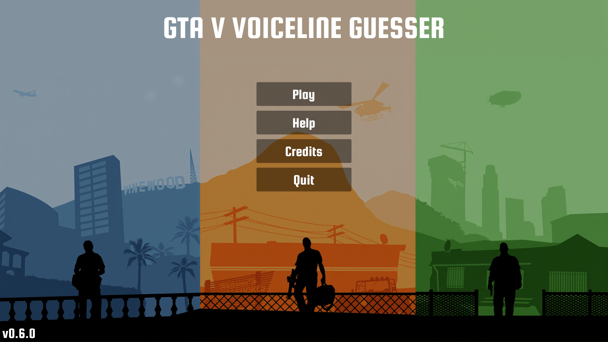
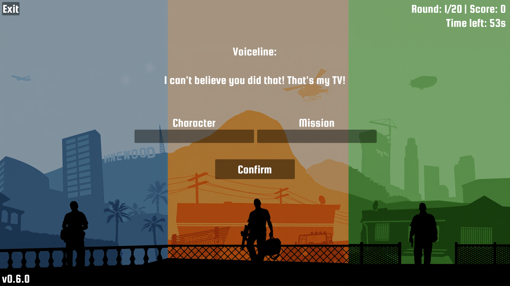
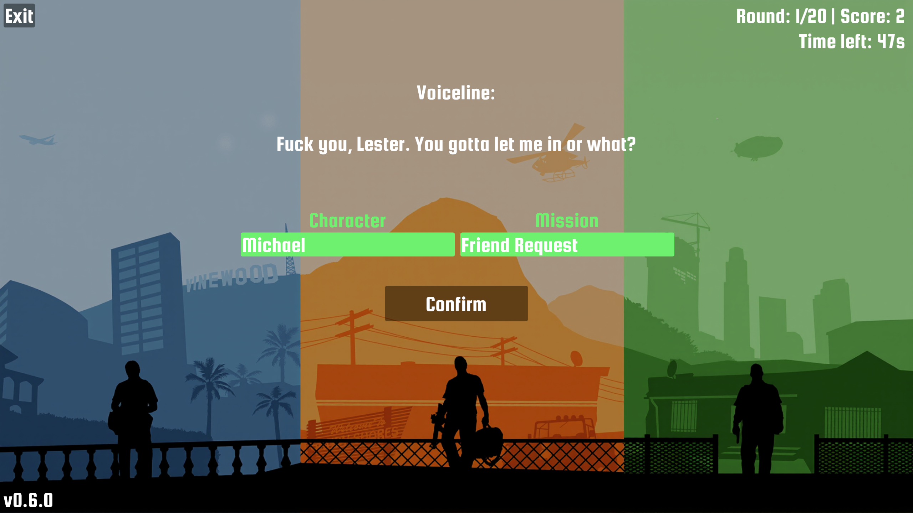
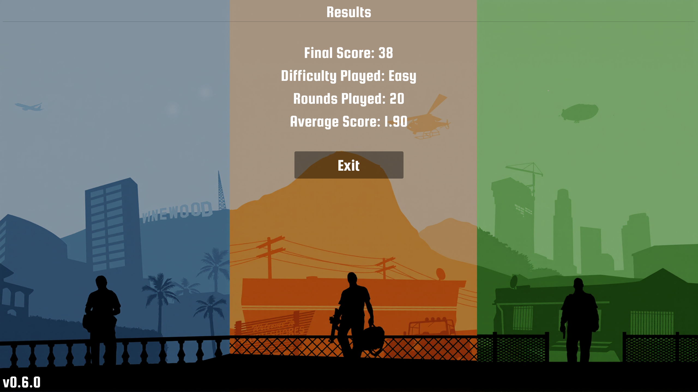

<h1>
  
  Chris6ix's GTA V Voiceline Guesser
</h1>

A free GTA V guessing game where you're given a random voiceline from the game and need to identify who said it and which mission it was spoken on.

<table>
  <tr>
    <td align="center">
      
    </td>
    <td align="center">
      
    </td>
  </tr>
  <tr>
    <td align="center">
      
    </td>
    <td align="center">
      
    </td>
  </tr>
</table>

## 🎮 Game Rules

There are up to 2 points available per question:

- 1 point for correctly identifying the character
- 1 point for correctly identifying the mission

Input is case insensitive.

### General Rules

- Short and generic expressions are not included (e.g. "Come on!" or "Hey!").
- Lines spoken by unnamed characters are not included (e.g. "Security Guard" or "Woman").

### Mission Classification

For the purposes of this game, missions are classified as follows:

- Main missions: All missions required to reach an ending, including all heist approaches and setups, as well as all three possible endings.
- Side missions: All other missions, plus Pulling Favors because Rockstar classifies it as Strangers & Freaks even though it gates story progression.

### Difficulty Levels

#### 🟢 Easy - Recommended for most players

Easy mode focuses on highly recognizable lines from the main missions. Intended for players who know the game and its most iconic dialogue.

- Alternative dialogue is generally excluded.
- Some optional dialogue is included, provided it occurs early enough or naturally enough during a normal playthrough that a player is likely to hear it.
- Some alternative dialogue may be included if the line is particularly recognizable or easy to attribute, meaning a player could reasonably guess it even without having encountered that specific variation.
- Alternative spellings or slight misspellings of certain character names are accepted (see the character list below).

#### 🟡 Normal

Normal mode includes recognizable lines from both main and side missions. Intended for players who are familiar with the game and its dialogue.

- Alternative dialogue is generally excluded.
- Some optional dialogue is included, provided it is reasonably likely to be heard during a normal playthrough.
- Some alternative dialogue may be included if the line is particularly recognizable or easy to attribute, meaning a player could reasonably guess it even without having encountered that specific variation.

#### 🔴 Hard

Hard mode includes difficult lines from anywhere in the game. Intended for players who know the game's dialogue incredibly well.

- Alternative dialogue is included.

#### 🟣 Extreme

Extreme mode is intended for true dialogue experts who know the game inside out.

- Includes dialogue from anywhere in the game.
- Particularly obscure or niche lines may be included.

## 📋 Requirements

- Operating System: Windows or Linux
- GPU: Vulkan 1.3 capable (GPUs released in 2018 or later should be supported.)

## 📥 Installation

- Download the latest release for your platform from the [GitHub Releases page](https://github.com/Chris6ix/GTA-V-Voiceline-Guesser/releases).
- Download the appropriate `.zip` file for your platform.
- Extract the contents of the ZIP file.

### 🐧 Linux Only

You must set the `Exec` and `Icon` lines in the `.desktop` file to the **absolute paths** to the executable and icon on your system. Save the file and make it executable.

If you don't know how to do this, follow the instructions below:

- Open the extracted game folder.
- Open GTAVVoicelineGuesser-VERSION.desktop in a text editor.
- Find the following two lines:

```
Exec=ENTER_ABSOLUTE_PATH_TO_EXTRACTED_ZIP/bin/GTAVVoicelineGuesser-VERSION-Linux
Icon=ENTER_ABSOLUTE_PATH_TO_EXTRACTED_ZIP/assets/icons/GTAVVoicelineGuesser_Icon.bmp
```

Replace both paths with their **absolute paths** (the full paths to the files on your computer). Replace VERSION with the actual version you downloaded.

For example, if you extracted the game into `/home/username/Games/GTAVVoicelineGuesser`, the lines would look like this:

```
Exec=/home/username/Games/GTAVVoicelineGuesser/bin/GTAVoicelineGuesser-VERSION-Linux
Icon=/home/username/Games/GTAVVoicelineGuesser/assets/icons/GTAVVoicelineGuesser_Icon.bmp
```
- Save the `.desktop` file.
- Open a terminal in the extracted game folder and run:

```
chmod +x GTAVVoicelineGuesser-VERSION.desktop
```

Again, replace VERSION with the actual version you downloaded.

## ▶️ Running the Game

Simply run the GTAVVoicelineGuesser `.exe` on Windows and the `.desktop` on Linux.

If you encounter an issue, see Issue Reporting.

## 📋 Currently Implemented Missions

The following missions are currently included:

Prologue, Franklin and Lamar, Pulling Favors, Repossession, Complications, Father/Son, Chop, Marriage Counseling, Daddy's Little Girl,

Friend Request, The Long Stretch, Casing The Jewel Store, Carabine Rifles, Bugstars Equipment, BZ Gas Grenades, The Jewel Store Job

## 👥 Currently Implemented Characters

The following characters are currently included:

Alternative spellings are shown in parentheses and are accepted by the game's Easy Mode where applicable.

Michael (Micheal), Trevor, Brad, Jaspers, Priest, Dr. Friedlander, Franklin, Lamar, 

Simeon, Jimmy, Tonya (Tanya), Denise, Mr. Kenneth (Simeon's Customer), Tracey, Amanda,

Kyle (Tennis Coach), Hao, D, Blake, Freddy, Martin (Madrazo), Lester, Rickie, Jay Norris, Magenta Andrews, Stretch

Packie, Norm, Gustavo, Paige, Eddie, Karim, Tanisha

## 🐛 Issue Reporting

If you encounter a bug or other issue, please report it through the project's GitHub issue tracker.

When reporting an issue, run the game from a terminal with the -debug flag and include the relevant log output with your report.

On Linux you need to run the executable itself in `/bin` through a terminal, not the `.desktop` to get the debug log.

For issues involving a specific voiceline or round, please include only the relevant logs:

- The main log (Until just before the round 1 marker)
- The log for the round where the issue occurred

There is no need to include the entire game log unless it is relevant to the issue.

When possible, please also include:

- What you expected to happen
- What actually happened
- Steps to reproduce the issue

## 💡 Feature Suggestions

Have an idea for a new feature, game mode, or improvement?

Feel free to submit a feature request through the GitHub issue tracker. Please describe the idea and how you think it would improve the game.

Suggestions are welcome, although there is no guarantee that every suggestion will be implemented.

## 🎥 For Content Creators

You are welcome to record, stream, and publish gameplay of GTA V Voiceline Guesser, including videos that show the game in its entirety.

There are only two requirements:

1. **Credit the game.**  
   Please include a link to the game's GitHub page or otherwise clearly credit the game in your video, stream, description, pinned comment, or equivalent.

2. **Do not put the game behind a paid-only audience.**  
   The game may not be used as content that is exclusively available to paying supporters, such as YouTube Memberships or Patreon.

Regular monetized content is fine. The restriction only applies when access to the content featuring the game is itself limited to paying users.

## 📜 License

GTA V Voiceline Guesser is source-available, but is not open source under the Open Source Definition.

The source code may be inspected, modified, compiled, privately used, and reused in other projects. Contributions are welcome.

You may not distribute the game or modified playable versions of the game without permission from the copyright holder. This includes compiled builds, installers, packages, mirrors, and unofficial releases.

The game also contains third-party libraries and assets which are not covered by the project's license and remain subject to their respective licenses and rights holders. Their license texts and notices can be found in the /licenses directory and, where applicable, in the game's help/about menu.

For the complete terms, see the [`LICENSE.txt`](LICENSE.txt) file.

## 🤝 Contributions

Contributions are welcome and encouraged.

If you improve the game, please consider submitting your changes as a pull request so they can be reviewed and potentially incorporated into the official version.

See [`CONTRIBUTING.md`](CONTRIBUTING.md) for details.

## 📦 Third-party software and assets

This project includes third-party software, fonts, and other materials that are not covered by the project's own license and remain subject to their respective licenses and terms.

See [`THIRD_PARTY_NOTICES.md`](THIRD_PARTY_NOTICES.md) for the list of third-party components and applicable notices and licenses.

## 🎙️ Adding New Voicelines

Adding new voicelines is relatively simple, albeit tedious (Due to assigning difficulties to every voiceline).

The steps are as follows:

1. Get the dialogue of a mission and save it in a correctly labeled `.txt` file under `/resources/voicelines`

2. Format every line as `[DIFFICULTY][CHARACTER]:    LINE` (4 spaces between colon and line for readability).

   This can be done very quickly with an LLM, just make sure it isn't subject to automated content safety systems that will terminate/refuse the conversation when the game's profanity is detected (E.g. ChatGPT, Claude, etc. won't work, a local model is recommended).

3. Assign appropriate difficulties to the voicelines, while removing bad lines (Rules at the top).

   I recommend not using LLMs for this, as they struggle to accurately grade the voicelines, even with a large number of manually graded examples and the ruleset as context.

4. Add your new mission to the appropriate array at the top of `GTAVVoicelineGuesser.cpp`.

5. Run the VoicelineBundler executable in `/tools`.

6. Compile the game.

## ⚖️ Balancing Voiceline Difficulties

The difficulty ratings of the voicelines are inherently subjective. The current ratings were assigned by the project author based on the rules described in the Difficulty Levels section.

While those rules provide guidelines for assigning difficulties, they do not make the process completely objective, since the rules themselves are based on judgment.

Because of this, discussion and contributions regarding voiceline difficulty are welcome. If you believe a voiceline has been assigned an inappropriate difficulty, feel free to suggest or submit a balancing change and explain why you think it would be more appropriate.

## ⚠️ Disclaimer

This is a free, non-commercial, fan-made trivia game and is not affiliated with, sponsored by, or endorsed by Rockstar Games or Take-Two Interactive. Grand Theft Auto V, its characters, dialogue, names, and other related intellectual property are the property of their respective rights holders. Certain references to Grand Theft Auto V, including selected dialogue, character depictions, and visual elements inspired by the game, are included solely for the purpose of creating a fan-made trivia experience. The background artwork and other original assets included in this application are independently created and are not official Rockstar Games assets. No Rockstar Games software, game files, audio recordings, or other proprietary game assets are distributed with this application.
